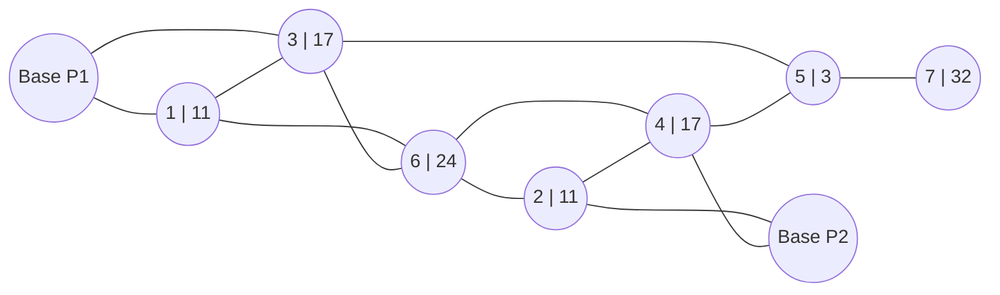
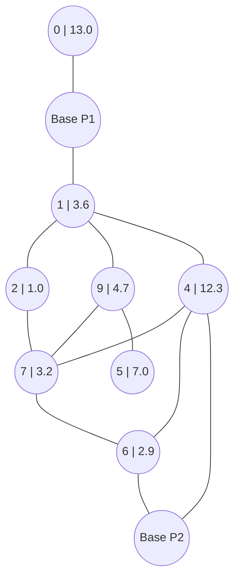

# Agentic AI Harness Design for Autonomous Strategy Programming

*Zentral Hack 2026 — Task Description*
Nando Käslin, R&D Engineer, CSEM · October 23, 2026

> Markdown conversion of the official task description (`zentralhack_2026_final.pdf`).
> Text is reproduced as written; figures are redrawn as diagrams or described in text.
> Where this document and the dev games' `spec.md` files disagree (scoring), this document is
> the official one.

## 1 What you build

You build an **agent harness**: a program that reads a written game specification, works out
how to play that game, writes a strategy as code, tests it, improves it, and outputs the
finished strategy, all on its own, inside a sandbox, on a fixed LLM and time budget. You do not
write the strategy for the game, your harness does, and it does so *after* you have stopped
working.

During the hackathon you are given two development games (*alpha* and *beta*) to build your
harness against. At the end you freeze your harness and hand it over. We then run it,
unattended, on **two other games you have never seen**: different games in the same family,
each with its own written specification, its own rules and its own simulator. Whatever
strategies your harness produces in these runs are what enter the tournament.

## 2 Setup

All code that concerns you is on GitHub, in the organisation

    https://github.com/zentralhack-2026-agentic-ai-harness

1. Go to the harness repository and click **Use this template** to create your own copy of the
   repository. Make it **private**, so that other teams cannot see your progress.
2. In your copy of the repository, go to *Settings*, and under *Access* invite your team members
   and the organiser account `nkaslin`.
3. Clone your copy of the repository to your machine and start developing your harness.
4. Read the `README.md` in your harness repository carefully: it explains the structure of the
   harness and how to use it.
5. Each team gets an OpenAI API budget of $100. At least one member of the team needs an OpenAI
   account; each team gets a promotional link to access this budget. Create an API key and put
   it into the `.env` file of your harness repository (see the `README.md`).

The other two repositories, `arena` and `arena-games-dev`, contain the game environment and the
development games. Your harness repository needs them to run the harness and the strategies it
produces, and installs them by itself. You do not have to understand their inner workings to
develop your harness, but their code is on GitHub for you to consult as needed.

## 3 The game family

All games, the development games and the unseen ones, belong to the same family and share the
following. A game is a competitive match between **two players** over a number of discrete
turns, in which both players move simultaneously. A strategy does not learn who its opponent
is. Each player controls a fleet of **units** deployed on **nodes**; nodes carry **demand**.

Every turn, each strategy receives an observation and returns an action, and the engine
validates and resolves both actions together. At the end of the match, the player with the
higher score wins. Observations and actions are Python literals: dicts, lists, tuples, numbers,
strings, booleans and `None`.

The development games *alpha* and *beta* are depicted in Appendices A and B.

## 4 The strategy contract

Your harness produces one file, `strategy.py` (`strategy_file` in `task.json`), that defines
the class `Strategy` (`strategy_class`) with the methods `__init__(self, player_id)` and
`act(self, obs)`. A new instance is created for every match, and `act` is called once per turn:
it gets that turn's observation and returns the action. The strategy is ordinary Python code
that uses the standard library only and imports nothing else, so your LLM budget buys its
*development*, never its play.

Every strategy runs in its own process, with a bare Python 3.13: no third-party packages, no
network, no files. Observations and actions are passed as Python literals. A strategy has 10 s
to start up and run `__init__`, 1 s per call of `act`, 2 GB of memory, and replies of at most
1 MB. Invalid actions are handled as the game's specification says. A strategy that raises an
exception, exceeds a limit or crashes **forfeits** the rest of the match: from then on it plays
`None`, and the match plays on to the end.

## 5 LLM access and budget

- OpenAI **Responses API** only, with function tools; `OpenAI()` reads key and endpoint from
  the environment, so the same code works in development and at evaluation.
- The allowed models and the budget (USD per run) are part of each task (`task.json`). The
  models are always among `gpt-6-luna`, `gpt-6.1-sol` and `gpt-6-astra`.
- The template already has a function that calculates the cost of each call, as the evaluation
  counts it (`harness.pricing.cost`): read the code.
- Allowed models and budget are enforced at evaluation, not during development: develop as if
  they were.

At evaluation, your harness is run on three tasks, the same for both unseen games. The budget
and the deadline hold per run:

| task | allowed models                | budget | deadline | score weight |
|------|-------------------------------|-------:|---------:|-------------:|
| A    | `gpt-6-luna`                  |  $0.03 |    3 min |          10% |
| B    | `gpt-6-luna`, `gpt-6.1-sol`   |  $0.50 |   10 min |          35% |
| C    | `gpt-6.1-sol`, `gpt-6-astra`  | $10.00 |   30 min |          55% |

## 6 How the event runs

1. **Development.** Your copy of the template, the two development games, your team's OpenAI
   key.
2. **Freeze.** Push a commit and tell us the commit; the organiser account must have access to
   your github repository. Everything after this point is automatic.
3. **Adaptation runs.** We run your harness at the freeze commit, unattended, on each unseen
   game, 5 times under each of the three tasks (Section 5). Every run produces a strategy. So
   your harness will end up producing 5 strategies per game, per task (budget) so in total 30
   strategies.
4. **Conformance.** Each strategy plays every seat against idle opponents and must never
   forfeit.
5. **Tournament.** Per game and task, the strategies of all teams play each other in a
   tournament on multiple seeds in both player seats. Strategies coming from the same harness
   don't play each other. Winning individual matches counts, not the total score collected.
   Winning a match will award the strategy +1 score, drawing 0, and losing −1.

## 7 Deliverable

- Your private copy of the harness repository, at the freeze commit: we run that, not your
  working tree; anything uncommitted does not exist. It runs unattended as the `harness` script
  its `pyproject.toml` defines, with no arguments; `run.sh` runs it locally the same way.
- A short `report.md` at the submitted commit that describes your approach.
- A short presentation of your approach.

## 8 Scoring

For each task (budget) the total score of each team will get summed up, multiplied by the
weight of the task and added up over the three tasks. Example for one team, with the unseen
games H1 and H2 and the 5 strategies per game and task:

| strategy     | task A · H1 | task A · H2 | task B · H1 | task B · H2 | task C · H1 | task C · H2 |
|--------------|------------:|------------:|------------:|------------:|------------:|------------:|
| 0            |           4 |          −1 |           9 |           6 |          15 |          13 |
| 1            |          −2 |           2 |          12 |          −2 |          18 |           9 |
| 2            |           6 |           5 |           7 |          11 |          11 |          17 |
| 3            |           0 |          −3 |          10 |           4 |          20 |          12 |
| 4            |           3 |           1 |           8 |           9 |          14 |          16 |
| **sum**      |          11 |           4 |          46 |          28 |          78 |          67 |
| task total   |  15 |  |  74 |  | 145 |  |
| × weight     | × 0.10 = 1.50 |  | × 0.35 = 25.90 |  | × 0.55 = 79.75 |  |

**Final score** = 1.50 + 25.90 + 79.75 = **107.15**

In the event that the winner cannot be clearly identified from the final scores, the
presentations and approaches of the teams will be judged by a panel of experts, and the winner
will be determined in that way.

Contact: *Nando Käslin, nando.kaeslin@csem.com*

---

## Appendix

### A Development Game Alpha

A city is represented by an undirected graph. Each neighborhood in the city is a node $v$ and
carries a service demand $d_v$ (i.e. demand for tasks that service drones can complete). Two
companies each control a fleet of service drones that all start at their own base, and compete
to serve that demand over $T$ turns. Each drone serves at most $c$ tasks per turn.

Each turn, both players simultaneously move any number of their drones from a node to an
*adjacent* node.

**Payout.** Let $n_v^p(t)$ be the number of drones player $p$ has at node $v$ at time $t$. The
reward collected at that node is

$$
r_v^p(t) \;=\; \min\!\left( c\,n_v^p(t)\,,\;\; d_v(t)\cdot\frac{n_v^p(t)}{n_v^1(t) + n_v^2(t)} \right),
\qquad \tfrac{0}{0} := 0,
$$

i.e. a contested node is split in proportion to fleet size, and no player can serve more than
its capacity. A player's score is $\sum_t \sum_v r_v^p(t)$.

*Figure: the alpha map (`node | demand`). "Base P1" is player 0's base (node 0), "Base P2" is
player 1's base (node 8) in the spec's numbering.*

node | demand · 20 drones per player, each of capacity 5 · $T = 100$ turns

### B Development Game Beta

Beta keeps the rules of alpha: drones move at most one edge per turn, and a node's demand is
split as in alpha's payout. It adds three things.

**A random map.** Every match is played on a new random connected graph with 10 to 16 nodes,
with the two bases at least three edges apart. The map is part of every observation.

**Demand that grows and moves.** The total demand grows over the match, from between 40 and 60
on the first turn to between 110 and 140 on the last, along a curve drawn at random for each
match (see the plot below). It is split between the nodes by weights that drift from turn to
turn, so demand moves around the map. Each turn, a strategy sees the exact demand of the
current turn and the next four, but not the curve.

**Upkeep.** Each player has $N = 30$ drones of capacity $c = 5$. Every drone that is not on its
own base $b_p$ costs $u = 2$ per turn, so a player's profit in turn $t$ is

$$
\pi^p(t) \;=\; \sum_v r_v^p(t) \;-\; u\,\bigl(N - n_{b_p}^p(t)\bigr),
$$

and its score is $\sum_t \pi^p(t)$. A score can be negative; a player that never moves scores
exactly 0.

*Figure: a random map, with the demand of turn 0 (`node | demand`).*

*Figure: total demand over a match, by curve shape.* All four shapes start at the same total
demand on turn 0 (about 50 in the plot) and end at the same value on turn 99 (about 125):
**linear** rises steadily, **early** rises fast and then levels off (above linear), **late**
rises slowly and then fast (below linear), and **s-curve** is slow, then fast, then slow
(crossing the others in the middle).
