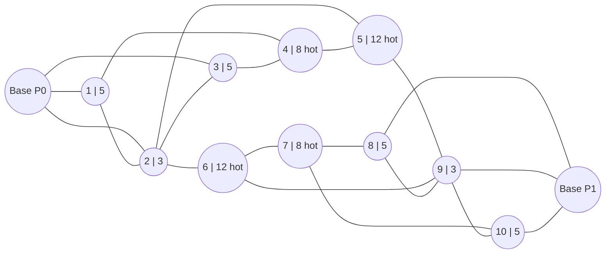

# Game Eta

## Overview

Two players compete for demand on a fixed graph over a fixed number of turns. Each player has a
fleet of battery-powered rovers. Each turn, both players move rovers between nodes; rovers present
at a node capture a share of that node's demand proportional to the capacity they bring.

The twist is the **battery**. A rover loses energy every turn it spends away from its own base,
and moving costs extra energy. It recharges only on its own base. A rover whose battery reaches
`0` is **stranded for good**: it never moves or earns again, and its player pays a towing fee for
it every turn until the end of the match. Rovers must therefore commute: go out, serve, come home
in time, recharge, go out again.

Demand is constant per node, except on four **hot** nodes, whose demand doubles every 10th turn.
Which turns are hot is the only thing that changes from match to match; it is in the observation.

A player's profit is the demand it serves minus the towing fees it pays, summed over the whole
game. The player with the higher profit wins the match (see "Tournament and ranking").

This document is the complete definition of the game. You will not get the game's source code or
a simulator, so everything needed to write a strategy, or to build your own simulator, is here.
Your deliverable is one Python class, described in "Your strategy".

## Constants

Every constant in this document, as Python you can copy:

```python
N_TURNS = 100
UNITS_PER_PLAYER = 16
UNIT_CAPACITY = 4
BATTERY_MAX = 10  # every rover starts at its base with a full battery
DRAIN = 1  # energy lost at the end of every turn a rover ends away from its own base
MOVE_COST = 1  # extra energy for moving one edge
RECHARGE = 3  # energy gained at the end of every turn a rover ends on its own base
TOW_FEE = 1.0  # per stranded rover, per turn

N_NODES = 12
BASES = [0, 11]  # index = player_id
NODE_DEMANDS = [0, 5, 3, 5, 8, 12, 12, 8, 5, 3, 5, 0]  # index = node id
EDGES = [
    (0, 1),
    (0, 2),
    (0, 3),
    (1, 2),
    (1, 4),
    (2, 3),
    (2, 5),
    (2, 6),
    (3, 4),
    (4, 5),
    (5, 9),
    (6, 7),
    (6, 9),
    (7, 8),
    (7, 10),
    (8, 9),
    (8, 11),
    (9, 10),
    (9, 11),
    (10, 11),
]  # undirected, (u, v) with u < v, sorted
HOT_NODES = [4, 5, 6, 7]
HOT_PERIOD = 10  # a turn is hot when turn % HOT_PERIOD == hot_phase
HOT_MULTIPLIER = 2
```

## Seeds

Each match is created from an integer seed. The seed fixes one number, the match's `hot_phase`,
an integer from `0` to `9` (see "Demand"), before the first turn is played. Everything else (map,
bases, base demands, starting positions) is the same in every match, and nothing about the
environment depends on what the players do. In a tournament both players of a match, and every
pairing that plays the same seed, face exactly the same `hot_phase`.

You cannot compute `hot_phase` from the seed (the generator is not part of this definition), and
you do not need to: it is in every observation. Treat it as uniformly distributed over `0` to `9`.

## Map

The map is fixed and the same in every match. It is an undirected graph with 12 nodes, numbered
`0` to `11`. Node `0` is the base of player 0 and node `11` the base of player 1. Each number in a
node label (`node | demand`) is the node's demand on a normal turn.



| node | demand | hot | distance to base 0 | distance to base 11 | role                          |
|-----:|-------:|:---:|-------------------:|--------------------:|-------------------------------|
| 0    | 0      |     | 0                  | 4                   | base of player 0              |
| 1    | 5      |     | 1                  | 4                   | player 0's side               |
| 2    | 3      |     | 1                  | 3                   | player 0's side, junction     |
| 3    | 5      |     | 1                  | 4                   | player 0's side               |
| 4    | 8      | yes | 2                  | 3                   | player 0's backyard           |
| 5    | 12     | yes | 2                  | 2                   | centre                        |
| 6    | 12     | yes | 2                  | 2                   | centre                        |
| 7    | 8      | yes | 3                  | 2                   | player 1's backyard           |
| 8    | 5      |     | 4                  | 1                   | player 1's side               |
| 9    | 3      |     | 3                  | 1                   | player 1's side, junction     |
| 10   | 5      |     | 4                  | 1                   | player 1's side               |
| 11   | 0      |     | 4                  | 0                   | base of player 1              |

Distances are shortest-path lengths in edges. The map is symmetric: node `i` plays the same role
for player 1 as node `11 - i` does for player 0, and `(u, v)` is an edge exactly when
`(11 - v, 11 - u)` is. Both centre nodes are 2 edges from both bases.

The map does not change during a match. It is in every observation: `n_nodes`, `edges`,
`player_base` and `opponent_base`.

## Demand

On turn `t` (from `0` to `N_TURNS - 1 = 99`), the demand of node `i` is

```
hot(t)       = (t % HOT_PERIOD == hot_phase)
demand[t][i] = NODE_DEMANDS[i] * HOT_MULTIPLIER   if hot(t) and i in HOT_NODES
               NODE_DEMANDS[i]                    otherwise
```

So exactly 10 turns of every match are hot: `hot_phase, hot_phase + 10, ..., hot_phase + 90`. On a
hot turn nodes 4 and 7 have demand 16 and nodes 5 and 6 have demand 24; all other nodes keep their
normal demand. Both bases always have demand `0`. Demands are Python `int`s.

The observation contains the demand of the current turn (`demand`) and `hot_phase`, so you can
compute the demand of every future turn yourself.

## Units

Each player has 16 rovers with ids `0` to `15`. All of them start on their own base with a full
battery (`energy = 10`). Every rover has capacity 4. Rovers are never created or destroyed. Any
number of rovers, from either player, may be at the same node. Rovers may move onto any node,
including the opponent's base (which has no demand and does not recharge them).

Every rover has an integer **energy** from `0` to `BATTERY_MAX = 10`:

- **Moving** one edge costs `MOVE_COST = 1` energy, paid when the rover moves. A rover can move
  only if it has at least 1 energy at the start of the turn.
- At the **end of every turn** (after all moves), every rover that is on its own base gains
  `RECHARGE = 3` energy (capped at 10), and every other rover loses `DRAIN = 1` energy (not below
  0). This happens whether the rover moved this turn or not.
- A rover with energy `0` after this update is **stranded**, permanently: it can never move again,
  it serves no demand, and its owner pays `TOW_FEE = 1.0` for it on this turn and every later
  turn. A stranded rover is never on its own base (a rover that ends a turn there has at least 3
  energy), so it never recharges. Stranded rovers stay on the map with energy `0` and do not take
  any share of a node's demand.

A rover that is not stranded is **active**. A turn away from home costs 2 energy if the rover
moved onto any node other than its own base (the opponent's base included) and 1 if it stayed
there. Moving onto its own base costs only the move (1): a rover that arrives home with 0 energy
left after the move recharges and ends the turn with 3.

**Getting home.** A rover at distance `d ≥ 1` from its own base, moving home along a shortest path
every turn, ends its intermediate turns with `e - 2`, `e - 4`, ... energy and arrives home if and
only if its energy `e` at the start of the first of those turns is at least `2 * d - 1`. A rover
that leaves home with a full battery (10) can therefore reach any node at distance 1 or 2 and come
back, but a node at distance 3 (it arrives with 4 energy, and needs 5) is a one-way trip.

For example, a rover of player 0 that leaves its base with 10 energy, goes to centre node 5 via
node 2, serves there, and comes back (all nodes otherwise empty, `hot_phase` 0, so the only hot
turn here is turn 0, when the rover is on node 2, which is not a hot node):

| turn | move      | node after | energy after | served |
|-----:|-----------|-----------:|-------------:|-------:|
| 0    | 0 → 2     | 2          | 8            | 3.0    |
| 1    | 2 → 5     | 5          | 6            | 4.0    |
| 2    | stay      | 5          | 5            | 4.0    |
| 3    | stay      | 5          | 4            | 4.0    |
| 4    | stay      | 5          | 3            | 4.0    |
| 5    | 5 → 2     | 2          | 1            | 3.0    |
| 6    | 2 → 0     | 0          | 3            | 0.0    |
| 7    | stay      | 0          | 6            | 0.0    |
| 8    | stay      | 0          | 9            | 0.0    |
| 9    | stay      | 0          | 10           | 0.0    |

Had it stayed on node 5 on turn 5 as well, it would have ended that turn with 2 energy, and moving
to node 2 on turn 6 would have stranded it there (`2 - 1 - 1 = 0`).

## Your strategy

A strategy is a Python class with two methods:

```python
class MyStrategy:
    def __init__(self, player_id: int) -> None:
        self.player_id = player_id  # 0 or 1

    def act(self, obs: dict) -> list[list[int]]:
        return []  # this turn's moves; see "Observation" and "Action"
```

- A new instance is created for every match, with `player_id` 0 or 1.
- `act` is called once per turn, 100 times per match. You can keep state on `self` between turns.
- Everything in the observation is from your point of view (`player_*` fields are yours,
  `opponent_*` fields are the opponent's), so you do not need `player_id` to play. Your base is
  node `0` if `player_id` is 0 and node `11` if it is 1; it is also `obs["player_base"]`. Node
  ids are the same for both players: the map is not mirrored for player 1.
- If `act` raises an exception, takes too long or crashes, you forfeit the rest of the match (see
  "End of game").

## Turn order

Each turn `t`:

1. both players' `act(obs)` are called with the observation for the current turn,
2. each returns its action (a list of moves),
3. both players' moves are applied (each moving rover pays `MOVE_COST`),
4. every rover's battery is updated (recharge on its own base, drain everywhere else) and rovers
   at energy 0 become stranded,
5. that turn's profit is paid out with `demand[t]` and the positions and energies after steps 3
   and 4 (see "Scoring"), then the turn number goes up by one.

Moves are simultaneous: neither player sees the other's moves for this turn before choosing its
own. Each player only moves its own rovers, so the order in which the two players' moves are
applied makes no difference. **Each rover moves at most one edge per turn.**

## Observation

Each turn your strategy's `act(obs)` receives a `dict`:

```python
{
    "turn": int,  # current turn, starting at 0
    "n_nodes": int,  # 12; node ids are 0 .. 11
    "edges": list[tuple[int, int]],  # EDGES: each undirected edge once, (u, v), u < v, sorted
    "player_base": int,  # node id of your base
    "opponent_base": int,  # node id of the opponent's base
    "hot_phase": int,  # 0 .. 9: turn t is hot when t % 10 == hot_phase (fixed for the match)
    "demand": list[int],  # length 12, index = node id: demand of the current turn
    "player_units": list[dict],  # your 16 rovers, sorted by id, each one:
    #   {"id": int, "node": int, "energy": int}  (energy 0 = stranded)
    "opponent_units": list[tuple[int, int]],  # the opponent's 16 rovers as (node, energy),
    #   sorted ascending; the opponent's rover ids are not shown
    "player_profit_last_turn": float,  # your profit in the last turn (can be negative)
    "opponent_profit_last_turn": float,  # the opponent's profit in the last turn
    "player_cumulative_profit": float,  # your total profit so far
    "opponent_cumulative_profit": float,  # the opponent's total profit so far
    "n_invalid_actions_last_turn": int,  # number of your illegal moves in the last turn
    "action_format_correct_last_turn": bool,  # whether your last action was well-formed
}
```

- `demand` is the demand of the **current turn**: the one your moves of this turn will be paid on,
  with the hot doubling already applied.
- `player_units` and `opponent_units` show the state at the start of the turn (after the previous
  turn's battery update): your rovers by id, the opponent's as a sorted list of pairs.
- You see the whole map, every rover's position and energy, and both players' profits. The total
  number of turns is not in the observation (see "End of game").

On turn 0 there is no last turn yet: all `*_profit_last_turn` and `*_cumulative_profit` fields
are `0.0`, `n_invalid_actions_last_turn` is `0`, and `action_format_correct_last_turn` is `True`.

## Action

Terms used below: an **action** is what `act` returns for one turn. It is a list of **moves**.

```python
[[unit_id, to_node], ...]
```

- Each move sends your rover `unit_id` from the node it is on to the adjacent node `to_node`.
- An empty list means "do nothing". Rovers that are not moved stay where they are (and still
  drain or recharge, see "Units").
- Moves in the list are applied in order.

Note that a move is a **list** of two ints, not a tuple. This is the opposite of what many
similar games use; a tuple is malformed here.

Two things can go wrong, and next turn's observation reports them separately.

**Malformed action:** the whole action is ignored for that turn, as if you had returned `[]`.
Next turn, `action_format_correct_last_turn` is `False` and `n_invalid_actions_last_turn` is `0`,
because no move was looked at. Returning `None` is malformed and therefore a no-op. The format is
checked strictly:

- the action must be a `list` (not a tuple, not `None`, not a dict, not any other type),
- each move must be a `list` of exactly 2 items (a tuple like `(3, 4)` is malformed),
- each item must be a plain Python `int`. `bool` values, floats and numpy integers such as
  `np.int64` are malformed. Convert them with `int(...)`.

**Illegal move:** the action is well-formed, but one move breaks a rule. Only that move is
skipped, the rest of the list still applies, and it adds 1 to `n_invalid_actions_last_turn`. A
move is illegal if:

- `unit_id` is not one of your rover ids (`0` to `15`),
- that rover has already moved earlier in the same list (each rover moves at most once per turn;
  an earlier move of the same rover that was itself illegal does not count, so in
  `[[0, 5], [0, 1]]` from the start the first move is illegal and the second one applies),
- that rover is stranded (energy `0`),
- `to_node` is not a node id (`0` to `11`),
- `to_node` is not connected by an edge to the node the rover is on (this includes moving a rover
  to the node it is already on).

## Scoring

After all moves and the battery update, each player's profit for the turn is its **revenue**
minus its **towing fees**.

**Revenue.** Each node's demand of this turn is split between the players' **active** rovers at
that node (stranded rovers do not count):

```
capacity_i = active_rovers_i * UNIT_CAPACITY                 # UNIT_CAPACITY = 4
served_i   = capacity_i * demand / max(total_capacity, demand)
```

`total_capacity` is the sum of both players' capacity at that node. The formula has two cases:

- **Demand exceeds total capacity** (`total_capacity < demand`): every player serves its full
  capacity, `served_i = capacity_i`, and part of the demand goes unserved.
- **Total capacity meets or exceeds demand** (`total_capacity >= demand`): the demand is shared
  in proportion to capacity (that is, to the number of active rovers),
  `served_i = demand * capacity_i / total_capacity`.

A node with no demand or no active rovers contributes nothing. Your revenue for a turn is the sum
of `served_i` over all nodes.

**Towing fees.** You pay `TOW_FEE = 1.0` for each of your stranded rovers, on every turn from the
turn it strands until the end of the match:

```
profit_i = revenue_i - TOW_FEE * stranded_rovers_i
```

Profit can be negative. Your score in a match is the sum of your profits over all turns. A player
that never moves scores exactly `0`. A rover stranded on turn `t` costs `100 - t` in fees in total
(turns `t` to `99`), so stranding early is very expensive, while in the last few turns it can be
worth spending a battery completely.

For example, at centre node 5 (demand 12 on a normal turn, 24 on a hot turn):

- 2 of your rovers alone serve `min(8, 12) = 8`; 3 alone serve 12 (capacity 12 meets the demand);
  a fourth rover would add nothing.
- 2 of your rovers against 3 of the opponent's: total capacity 20 ≥ 12, so you serve
  `12 * 8 / 20 = 4.8` and the opponent `12 * 12 / 20 = 7.2`.
- The same rovers on a hot turn: total capacity 20 < 24, so you serve your full 8 and the
  opponent 12.
- If you also have one stranded rover anywhere, your profit for that turn is `4.8 - 1.0 = 3.8`
  (normal turn).

### Worked example: turns 0 and 1

This is a real match whose `hot_phase` is `0`, so turn 0 is hot. Player 0's observation on turn 0
is:

```python
{
    "turn": 0,
    "n_nodes": 12,
    "edges": [
        (0, 1),
        (0, 2),
        (0, 3),
        (1, 2),
        (1, 4),
        (2, 3),
        (2, 5),
        (2, 6),
        (3, 4),
        (4, 5),
        (5, 9),
        (6, 7),
        (6, 9),
        (7, 8),
        (7, 10),
        (8, 9),
        (8, 11),
        (9, 10),
        (9, 11),
        (10, 11),
    ],
    "player_base": 0,
    "opponent_base": 11,
    "hot_phase": 0,
    "demand": [0, 5, 3, 5, 16, 24, 24, 16, 5, 3, 5, 0],
    "player_units": [
        {"id": 0, "node": 0, "energy": 10},
        {"id": 1, "node": 0, "energy": 10},
        {"id": 2, "node": 0, "energy": 10},
        {"id": 3, "node": 0, "energy": 10},
        {"id": 4, "node": 0, "energy": 10},
        {"id": 5, "node": 0, "energy": 10},
        {"id": 6, "node": 0, "energy": 10},
        {"id": 7, "node": 0, "energy": 10},
        {"id": 8, "node": 0, "energy": 10},
        {"id": 9, "node": 0, "energy": 10},
        {"id": 10, "node": 0, "energy": 10},
        {"id": 11, "node": 0, "energy": 10},
        {"id": 12, "node": 0, "energy": 10},
        {"id": 13, "node": 0, "energy": 10},
        {"id": 14, "node": 0, "energy": 10},
        {"id": 15, "node": 0, "energy": 10},
    ],
    "opponent_units": [
        (11, 10),
        (11, 10),
        (11, 10),
        (11, 10),
        (11, 10),
        (11, 10),
        (11, 10),
        (11, 10),
        (11, 10),
        (11, 10),
        (11, 10),
        (11, 10),
        (11, 10),
        (11, 10),
        (11, 10),
        (11, 10),
    ],
    "player_profit_last_turn": 0.0,
    "opponent_profit_last_turn": 0.0,
    "player_cumulative_profit": 0.0,
    "opponent_cumulative_profit": 0.0,
    "n_invalid_actions_last_turn": 0,
    "action_format_correct_last_turn": True,
}
```

Player 1's observation is the same, except that `player_base` is `11`, `opponent_base` is `0`,
`player_units` lists player 1's rovers (all on node 11) and `opponent_units` is sixteen `(0, 10)`.

- Player 0 plays `[[0, 1], [1, 1], [2, 2], [3, 3], [5, 4], [0, 3]]`.
- Player 1 plays `[[0, 10], [1, 9], [2, 9], [3, 9]]`.

Player 0's move `[5, 4]` is illegal (node 4 is not adjacent to node 0, where rover 5 is), and so is
`[0, 3]` (rover 0 already moved this turn): 2 illegal moves, the other four apply. Every rover that
moved pays 1 for the move and 1 drain (`10 - 1 - 1 = 8`); the rovers still on their base recharge,
but are already full. No node is contested, and the hot nodes are empty, so the doubling earns
nobody anything. The payout uses the turn-0 demand:

| node | demand | rovers | capacity | served |
|-----:|-------:|-------:|---------:|-------:|
| 1    | 5      | P0: 2  | 8        | 5.0    |
| 2    | 3      | P0: 1  | 4        | 3.0    |
| 3    | 5      | P0: 1  | 4        | 4.0    |
| 9    | 3      | P1: 3  | 12       | 3.0    |
| 10   | 5      | P1: 1  | 4        | 4.0    |

| player | revenue | stranded | towing fees | profit |
|-------:|--------:|---------:|------------:|-------:|
| P0     | 12.0    | 0        | 0.0         | 12.0   |
| P1     | 7.0     | 0        | 0.0         | 7.0    |

Player 0's second rover on node 1 added only 1.0, and player 1's three rovers on node 9 share a
demand of 3 that one rover could have served alone. Player 0's observation on turn 1 is then:

```python
{
    "turn": 1,
    "n_nodes": 12,
    "edges": [
        (0, 1),
        (0, 2),
        (0, 3),
        (1, 2),
        (1, 4),
        (2, 3),
        (2, 5),
        (2, 6),
        (3, 4),
        (4, 5),
        (5, 9),
        (6, 7),
        (6, 9),
        (7, 8),
        (7, 10),
        (8, 9),
        (8, 11),
        (9, 10),
        (9, 11),
        (10, 11),
    ],
    "player_base": 0,
    "opponent_base": 11,
    "hot_phase": 0,
    "demand": [0, 5, 3, 5, 8, 12, 12, 8, 5, 3, 5, 0],
    "player_units": [
        {"id": 0, "node": 1, "energy": 8},
        {"id": 1, "node": 1, "energy": 8},
        {"id": 2, "node": 2, "energy": 8},
        {"id": 3, "node": 3, "energy": 8},
        {"id": 4, "node": 0, "energy": 10},
        {"id": 5, "node": 0, "energy": 10},
        {"id": 6, "node": 0, "energy": 10},
        {"id": 7, "node": 0, "energy": 10},
        {"id": 8, "node": 0, "energy": 10},
        {"id": 9, "node": 0, "energy": 10},
        {"id": 10, "node": 0, "energy": 10},
        {"id": 11, "node": 0, "energy": 10},
        {"id": 12, "node": 0, "energy": 10},
        {"id": 13, "node": 0, "energy": 10},
        {"id": 14, "node": 0, "energy": 10},
        {"id": 15, "node": 0, "energy": 10},
    ],
    "opponent_units": [
        (9, 8),
        (9, 8),
        (9, 8),
        (10, 8),
        (11, 10),
        (11, 10),
        (11, 10),
        (11, 10),
        (11, 10),
        (11, 10),
        (11, 10),
        (11, 10),
        (11, 10),
        (11, 10),
        (11, 10),
        (11, 10),
    ],
    "player_profit_last_turn": 12.0,
    "opponent_profit_last_turn": 7.0,
    "player_cumulative_profit": 12.0,
    "opponent_cumulative_profit": 7.0,
    "n_invalid_actions_last_turn": 2,
    "action_format_correct_last_turn": True,
}
```

Turn 1 is not hot (`1 % 10 != 0`), so the hot nodes are back to their normal demand; the next hot
turn is turn 10. Profits are Python floats and can carry rounding error in their last digits;
compare them with a tolerance.

## End of game

The game ends after 100 turns (turns 0 to 99). Each player's score is the profit it
collected; the higher score wins (see "Tournament and ranking").

Your strategy forfeits the rest of the match if it raises an exception, takes longer than
1 second for one call of `act` (10 seconds for `__init__`), or crashes. From that turn on your
moves are empty: your rovers stay where they are, still drain or recharge, still take their share
of each node's demand while they have energy, strand when their battery runs out and then cost
towing fees, and all of it still counts for your score. The match always plays on to the end, even
if both players have forfeited.

## Tournament and ranking

Every match has a result. The player with the higher score **wins** and the other one loses. If
the two scores differ by at most 1% of `|score_0| + |score_1|`, the match is a **draw** (two
scores of `0` are a draw). A strategy that forfeits stays in the match: its score still counts as
described in "End of game", and the result is decided by the scores alone.

Your strategy plays a tournament against the strategies of the other teams: every pairing plays in
both seats, on the same set of seeds. Each team takes part with several strategies (one per run
of its harness); strategies of the same team never play each other. No reference strategies take
part. A separate tournament is played for each game.

Only results count, not by how much a match was won or lost:

- A win counts 1, a draw ½, a loss 0. Your goal is to beat your opponent: lowering the
  opponent's score helps you exactly as much as raising your own.
- Every strategy gets a **rating** from all its results in the tournament, with the
  Bradley–Terry model: strategy A beats strategy B with probability
  `1 / (1 + 10 ** ((R_B - R_A) / 400))`, and the ratings `R` are those that make the observed
  results most likely (a draw counts as half a win for each). Unlike a plain win rate, a rating
  accounts for how strong the opponents were that a strategy happened to meet.
- A team's rating in a game is the mean of the ratings of its strategies. Across games, a team's
  ratings are averaged.
